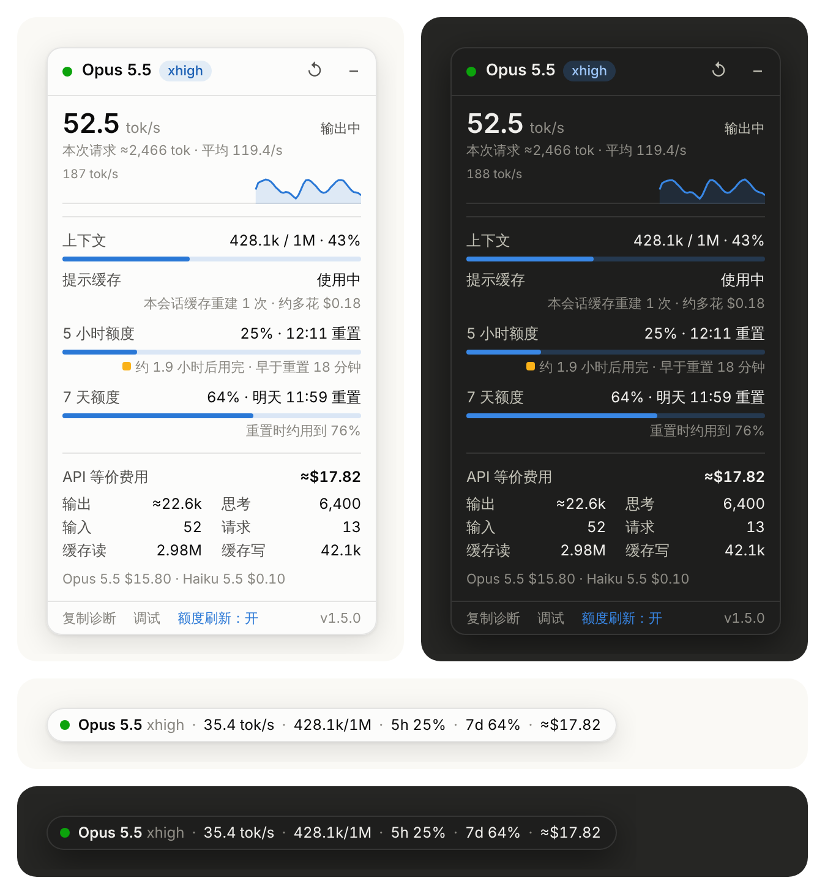

# Claude Token Meter

一个油猴（Tampermonkey / Violentmonkey）用户脚本，在 claude.ai（包括 Claude Code 网页端 `claude.ai/code`）上实时显示当前模型、推理强度、token 用量、生成速度、提示缓存和订阅额度。

**[点这里安装](https://raw.githubusercontent.com/query11/test/HEAD/claude-token-meter.user.js)**（需要先装好 Tampermonkey 或 Violentmonkey，见[安装](#安装)）



默认是右下角的一行摘要，例如：

```
● Opus 5.5 xhigh · 92.6 tok/s · 426k/1M · 5h 23% · 7d 64% · $15.10
```

依次是模型和推理强度、速度（生成时为实时速度，空闲时为上轮均速）、上下文占用、5 小时额度、API 等价费用。其他额度窗口用到一半以上时也会出现在这一行；提示缓存 10 分钟内就要过期时，会多出一项“缓存 8 分钟”。
点一下（或聚焦后按回车）展开完整面板，点面板右上角的 `–` 收回一行。

完整面板从上到下：

| 区域 | 含义 |
| --- | --- |
| 标题栏 | 当前模型（如 `Opus 5.5`）和推理强度（如 `xhigh`）；开了快速模式、ultracode 时另有标记。鼠标悬停可看到信息来源 |
| 速度 | 输出中：最近 2 秒的 tok/s 和本次请求的 token 数；思考中：按 CLI 报告的思考进度算出的速度；等待输出：已经等了多少秒；空闲：上轮均速（上一轮的输出 ÷ API 耗时，含首字延迟，所以比实时速度低）。最近一分钟有输出时下面有速度曲线 |
| 上下文 | 主对话最近一次请求的输入 token（含缓存）/ 模型上下文窗口；知道自动压缩阈值时比例条上有一道竖线 |
| 提示缓存 | 缓存还有多久过期；已过期时显示下一条消息要多花多少钱。下面一行是本会话缓存重建了几次、一共多花了多少 |
| 额度 | 各个订阅额度窗口的已用比例和重置时间，下面一行预测什么时候用完，例如“约 1.5 小时后用完 · 早于重置 40 分钟”；折合美元的剩余量在悬停提示里。开了额外用量时显示本月已用金额 |
| API 等价费用 | 整个会话按 API 标价估算的累计费用，订阅用户不按此计费。用过多个模型时下面列出各模型的费用 |
| 输出 / 思考 / 输入 / 请求 / 缓存读 / 缓存写 | 会话累计。输出含思考；思考是其中看不见的部分；请求是本页面看到的 API 请求次数（含子代理） |
| 底栏 | 复制诊断、调试日志开关、额度刷新开关、版本号 |

- 数字前的 `≈` 表示本轮还没结束，未结束部分是估算值；本轮结束后会换成精确值。鼠标悬停在各行上有说明。
- 比例条的颜色表示程度：蓝色正常，黄色偏高（上下文 ≥ 70%、额度 ≥ 75%），红色接近上限（≥ 90%，或额度已被拒绝）。claude.ai 用量接口给出的状态优先。百分比数字始终显示。
- 圆点：绿色 = 正在输出或思考，蓝色闪烁 = 请求进行中但暂时没有进度，灰色 = 空闲。
- 面板跟随 claude.ai 页面的浅色/深色主题（看页面实际背景色，不只看系统设置），放在 shadow DOM 里，不受页面样式影响。

### 模型和推理强度

模型取最新的一条线索：每轮开始时的 `system/init` 事件、每次请求实际服务的模型（`message.model`）、会话元数据。刚在网页上切换了模型时显示新设置的模型；拒答后换用了别的模型时显示实际服务的那个。悬停在模型名上能看到两者不一致的情况。

推理强度（`low` / `medium` / `high` / `xhigh` / `max`）来自：

1. 云端会话的元数据 `external_metadata.effort_level`（网页加载会话时会拿到）；
2. 会话设置 `get_settings` 的响应、`system/init` 里的 `effort`（有的宿主会带）；
3. 在网页上切换推理强度时发出的 `apply_flag_settings` 请求，切换后立刻更新。

都没有时不显示推理强度，悬停提示“未知”。模型不支持推理强度时也不显示。

### 提示缓存

主对话的每次请求都会读上一次请求留下的提示缓存，缓存读取的单价只有输入的几十分之一。缓存在最后一次请求之后按 TTL 过期：Claude Code 给订阅用户的主对话用 1 小时缓存，用到额外用量时是 5 分钟（脚本从每次请求的 `usage.cache_creation` 里看是哪一种）。
过期之后，下一条消息要把整个上下文按缓存写入价（1 小时缓存是输入单价的 2 倍）重写一遍。以 Opus 5.5 为例，426k 的上下文重写一次约多花 $3.3，也照样消耗订阅额度。切换模型、推理强度、快速模式也会让缓存失效。

- “提示缓存”一行：请求进行中显示“使用中”；空闲时显示还剩多久过期，10 分钟以内时标黄，一行摘要里也会出现；过期后显示“已过期 · 下条约多花 $X”。
- 下面一行统计本会话的缓存重建：上一次请求的整个提示本该从缓存读出来，实际读到的少很多，就算重建了一次。悬停可以看到最近几次的时间、原因（闲置超时、切换了模型、改了推理强度、切换了快速模式，或者原因不明）、重写了多少 token、多花了多少。`/clear` 和上下文压缩之后的重建是正常的，不算在内。
- 价格按 2026 年 10 月的 API 标价（输入单价和缓存读取单价，快速模式翻倍）；价目表里没有的模型，按本会话的花费反推单价。

### 用量统计

- 会话累计用量和费用来自 `result` 事件里的 `modelUsage` / `total_cost_usd`。它们是 CLI 这段运行的累计值：`/clear` 之后（以及续接时没有存档）会从零重新开始。脚本按先后把 `result` 分段，累计值变小、某个模型的累计值消失，或者两条之间有 `/clear`（`conversation_reset` 事件），就开始新的一段。各段最后一条相加，才是整个会话的用量。之前的版本只取最新一条，`/clear` 之后显示的费用会变少。
- 上轮输出和上轮均速取同一段里相邻两条 `result` 的差，包含子代理的请求。`result.usage` 只含主对话，只在一段的第一条没有可比的上一条时才用它。
- 对话内容（用户消息、工具调用和结果、正文）里的 JSON 不当成事件解析。之前 Claude 读到一个含 stream-json 的日志文件时，里面的 `result` 会被当成真的，把统计带偏。

### 额度刷新

额度读数平时只随请求更新：两轮之间、在别的设备上用过之后都会过时，窗口重置之后也要等下一次请求才知道新窗口的用量。
脚本会低频地查一下 claude.ai 设置里用量页面用的同一个只读接口（`/api/organizations/<组织>/usage`）：页面可见时每 3 分钟一次，一轮结束后、展开面板时最多每分钟一次，多个标签页共用一次结果。
它返回的是服务端的准确数字，包括按模型单独计算的周额度（例如 `7 天 Fable`）和额外用量。

- 只读，不改任何设置。在面板底部点“额度刷新”可以关掉，关掉后额度只随请求更新（和之前的版本一样）。
- 接口连续失败 3 次（比如接口改了）会自己停下，底栏显示“额度刷新：失败”，悬停可看到原因，点一下重试。
- 打开 claude.ai 的用量设置页面时，脚本也会顺便读到那里的数字。
- 窗口过了重置时间、又还没有新读数时显示“已重置 · 待更新”，不再当成 0%。

### 额度预测

每个额度窗口下面一行预测按现在的速度什么时候用完：

- 5 小时额度看最近的消耗速度：至少回看 30 分钟；30 分钟里涨不到 3 个百分点，就看 60 或 90 分钟。读数不够时，用这个窗口开始以来的平均速度。
- 周额度（7 天额度、按模型单独计算的周额度）用本周开始以来的平均速度，把不用的时候也算进去。按一阵忙碌的速度去算，会预测得太早。
- 会在重置前用完时显示“约 1.5 小时后用完 · 早于重置 40 分钟”，标黄（半小时内用完时标红）；用不完时显示“重置时约用到 64%”。悬停可以看到依据的时间段和每小时涨多少。
- 读数历史存在浏览器里，多个标签页共用；开着额度刷新时每 3 分钟有一个读数，预测更及时。

### 额度折合多少钱

在额度行下面一行悬停，可以看到剩余额度折合多少美元、按你的用法能让模型跑多久，例如“约剩 $230 · 12 小时”。预测不出来（刚开始用）时，这一行显示的就是它。
额度只给百分比，不说一个百分点是多少。脚本拿本会话的花费去对：

1. 每次请求花了多少钱是知道的：每轮的花费是同一段里相邻两条 `result` 的累计费用之差（包含子代理），再按 token 用量分到这一轮的各次请求上。
2. 额度每涨一个百分点时，会话累计花了多少钱也能对上。相邻两次跳变之间的花费 ÷ 跳过的百分点数，就是“每 1% 折合多少美元”。
3. 7 天这类涨得慢的额度另有一种算法：同一时刻两个额度都在读数里，看 5 小时额度涨多少格时它涨一格（你的账号大约是 8:1），再乘以 5 小时额度的单价。这种算法不用分摊花费，也不怕别处的使用。两种结果相差不到 40% 时用直接估算，差得多时用比例法。
4. 剩余美元 = (1 − 已用比例) × 100 × 每 1% 的美元数；剩余时间再按最近“每小时模型运行花多少钱”换算。

- 每个会话的估算按会话存在浏览器里，显示的是最近 30 个会话（45 天内）按花费加权的平均，所以换会话也能立刻看到，用得越多越准。1.4.0 修正了子代理较多时每轮花费算少的问题，之前存的估算（偏低）不再使用。
- 刚装上时显示“剩余：估算中”：要等这个页面看到额度涨过至少两次。5 小时额度很快；7 天额度要多用一阵。打开一个用过不少的会话，也能直接从历史记录里算。
- 前提是统计期间账号没有别处的使用。脚本做了几层排除：
  - 会话闲置超过 5 分钟（比如两轮之间你去用了别的会话），闲置前后的读数不配对，闲置后的第一个读数也不当起点；
  - 一次跳好几格、本会话却没花多少的段，视为别处的使用；
  - 在 5 小时额度上发现的这种段，7 天额度的同一段也一并排除。
  - 读数偶尔会回落一格再回来，只有超过之前最大值才算涨了一格。

  和本会话同时进行、细水长流的使用仍然分辨不出来，会让估算偏小。
- “按标价折算”只是换算单位，Anthropic 内部怎么计量没有公开；换模型或用法差别很大（比如很少命中缓存）时会不准。时间换算尤其依赖用法。

## 安装

1. 浏览器安装 [Tampermonkey](https://www.tampermonkey.net/) 或 Violentmonkey。
2. 打开安装链接 <https://raw.githubusercontent.com/query11/test/HEAD/claude-token-meter.user.js>，在弹出的页面里点“安装”。
3. 刷新 claude.ai 页面。

脚本头里写了更新地址，Tampermonkey 会定期检查仓库默认分支上的新版本（看 `@version`），也可以在 Tampermonkey 的脚本列表里手动“检查更新”。
之前手动粘贴安装的，用上面的链接重新安装一次就会覆盖成可自动更新的版本（存在浏览器里的额度和估算数据不受影响）。

拖动可以移动（一行摘要直接拖，完整面板拖标题栏），位置按离得最近的屏幕角记住，展开时朝屏幕内侧伸展。
`↺` 清零当前会话的统计（订阅额度不清）。

## 原理

脚本在页面加载最早阶段挂钩 `fetch`、`XMLHttpRequest`、`WebSocket`、`EventSource`，旁听流过的数据，不修改请求。
网页发出的数据只看切换模型、推理强度的控制请求。除了上面说的额度刷新，脚本自己不发请求。
从 Claude Code stream-json 事件和会话数据里读取：

| 数据 | 用途 |
| --- | --- |
| `type: "result"` 的 `modelUsage`、`total_cost_usd` | 会话累计用量、思考 token、各模型费用。是这段运行的累计值，按段取最后一条再相加 |
| `type: "assistant"` 的 `message.usage`、`message.model` | 本轮还没结束时的输入/缓存用量（按 `message.id` 去重）；主对话的实际服务模型；`usage.cache_creation` 里 5 分钟、1 小时缓存各写了多少（缓存的 TTL） |
| `stream_event` 里的 `message_start`、`content_block_delta` | 实时速度（按字符估算）、实际服务的模型 |
| `stream_event` 里的 `message_delta` | 每次请求的精确输出数，也用来校准估算 |
| `system/thinking_tokens` | 看不见的思考的进度（估算的思考 token 数），思考时的速度 |
| `system/init` | 每轮开始时的模型、快速模式，部分宿主还有推理强度 |
| 会话对象的 `external_metadata` | 云端会话的模型、上次实际服务的模型、推理强度（`effort_level`）、上下文占用 |
| `get_settings`、`get_context_usage` 的响应 | 生效的模型和推理强度；上下文占用和自动压缩阈值 |
| 网页发出的 `set_model`、`apply_flag_settings` 控制请求 | 刚切换的模型、推理强度 |
| `conversation_reset`（`/clear`） | 累计值从零重新开始；之前的上下文作废 |
| `system/compact_boundary` | 上下文压缩：压缩后的大小；之后的缓存重建不算多花 |
| `result` 里 `duration_api_ms` 的增量 | 上轮均速（同一段里相邻两条之差） |
| `rate_limit_event` 的 `unifiedWindows` | 订阅额度：每个窗口的已用比例（0~1）和重置时间；和本会话花费对照得出剩余估算 |
| claude.ai 用量接口、`/usage` 的结构化结果 | 订阅额度的准确读数（百分比 0~100、ISO 重置时间，服务端排好的额度行）、额外用量；连同上一行的读数一起记成历史，用来预测什么时候用完 |

几点要注意：

- `assistant` 事件里的 `output_tokens` 只是请求刚开始时的占位值（个位数），不能当输出量用，所以输出量以 `result` 为准。
- 逐字的 `stream_event` 只在回复生成时实时推送，不会保存进历史。打开一个已经答完的会话时没有实时速度，但“上轮均速”和用量都能从历史里算出来。
- 网页端看不到思考内容。CLI 报告思考进度（`thinking_tokens`）时显示思考速度，否则圆点为蓝色闪烁、显示已等待的秒数；思考 token 会出现在精确的输出数里。
- 历史记录（一次加载多条）只计入用量，不计入速度。切换会话时自动清零。
- 订阅额度是账号级的：不随会话清零，存在浏览器里，换会话、刷新、开多个标签页都能看到。同一个额度窗口里用量只增不减，所以显示的是观察到的最大值。

## 如果数字不对或不动

claude.ai 前端的内部接口没有公开文档，格式可能会变。排查方法：

1. 点面板底部的“复制诊断”，把复制出来的 JSON 贴出来。里面是解析出的状态（模型和来源、各段累计值、额度、各类事件的数量），不含对话内容。
2. 点“调试”，打开 DevTools 控制台，发一条消息，看有没有 `[token-meter]` 日志：
   - 有 `fetch` / `websocket` 行但没有事件类型行 → 数据格式不同（或是二进制），把一段原始数据贴出来即可适配；
   - 一行都没有 → 数据走了脚本没挂钩的通道。
3. 控制台里 `__ctm.state` 查看内部状态，`__ctm.live` 查看当前的流式状态，`__ctm.totals()` / `__ctm.runs()` / `__ctm.model()` / `__ctm.context()` / `__ctm.cache()` / `__ctm.limits` / `__ctm.forecast()` / `__ctm.quota()` 查看计算结果，`__ctm.ingest('<json 文本>')` 手动喂数据测试。

## 开发

`tests/` 里是回归测试，不用装依赖（Node 20 以上），在仓库根目录运行：

```
node --test
```

`tests/harness.js` 在 Node 里加载脚本：桩掉用到的浏览器对象，时间由测试控制，不建面板；用 `__ctm.ingest` 喂 Claude Code stream-json 形状的事件，再检查 `__ctm` 算出的结果。
用例覆盖实时流（长时间思考、子代理、漏掉 `message_stop`）、按 `/clear` 分段的累计值和去重、额度读数合并与用完时间预测、每 1% 折合多少美元（读数回落、闲置）。事件是照着脚本解析的格式构造的，不是录下来的真实数据。

`CTM_SCRIPT` 可以换成别的版本跑同一组用例，比如确认新用例在修复前的版本上会失败：

```
git show HEAD~1:claude-token-meter.user.js > /tmp/old.user.js
CTM_SCRIPT=/tmp/old.user.js node --test
```
