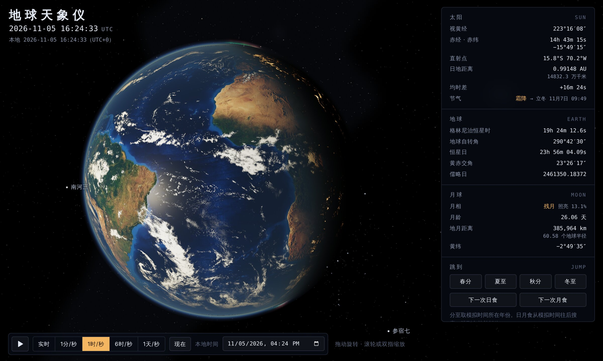

# 地球天象仪

按真实时间计算的 3D 地球：地球按地球自转角转动，太阳和月球在当时的真实方向上，背后是按 J2000 坐标摆放的 41411 颗恒星。昼夜分界、季节、月相、日食的月影、月食的红月亮，都是从星历算出来的，不是动画。



## 打开

直接用浏览器打开 `earth/index.html` 即可（需要联网，three.js 从 cdnjs 加载）。所有纹理和星表都打包在 `assets/*.js` 里，以 `data:` URI 的形式载入，所以从本地磁盘（`file://`）打开也能用。

操作：拖动旋转，滚轮或双指缩放；画布获得焦点后方向键旋转、`+`/`-` 缩放、空格暂停。

## 画面里有什么

**地球表面**

- 白天：NASA Blue Marble 4096×2048 纹理；地形高程图扰动法线（夸张约 15 倍），晨昏线附近山脉会有长影。
- 海洋：GGX 微表面高光 + 菲涅耳反射（水的 F0 = 0.02），太阳耀斑出现在相机和太阳的“镜面点”上。
- 夜晚：NASA Black Marble 城市灯光，太阳落到地平线下约 4° 之后才亮起，被云层挡住一部分。
- 月光：夜半球被月光照亮，亮度随月相变化（满月最亮）。
- 云层：真实云图，在地面上投下偏向背日方向的影子；云顶比地面高，晨昏线外还会被照亮一会儿。云随盛行风漂移：赤道两侧的信风带向西，中纬度西风带向东，极地东风带向西。
- 大气：瑞利散射 + 米氏散射的单次散射光线步进，光学厚度用查普曼函数近似。地球边缘的蓝色光晕、低太阳时阳光变红、晨昏线附近云顶的橙色，都来自散射计算。
- 极光：100–320 km 高度的发光层，围绕 2025 年的地磁北极（80.8°N, 72.7°W）和它的对跖点。极光卵在磁午夜一侧约磁纬 67°、正午一侧约 76°，下层绿光（氧原子 557.7 nm）、上层红光（氧原子 630.0 nm）、下缘一点紫光（氮分子离子）。
- 扁率：地球按 WGS-84 扁率 1/298.257 压扁（肉眼看不出，但它是对的）。

**天空**

- 恒星：依巴谷星表到 8 等的 41411 颗星，亮度按普森公式（每差 1 等亮度差 10^0.4 倍），颜色由 B−V 色指数换算色温（Ballesteros 2012）再换成黑体颜色。太空里没有大气，星星不闪烁。
- 银河：按 d3-celestial 的银河等照度线栅格化成赤经/赤纬图，银心在人马座。
- 太阳：按真实视半径（约 0.27°，随日地距离变化）画日面，加一圈眩光。
- 月球：真实距离（约 60 个地球半径）、真实大小，近月面始终朝向地球（潮汐锁定）。月面亮度用洛默尔–泽利格定律，所以满月看起来是一个均匀的圆盘，没有临边昏暗；暗面有地照。
- 星座：88 个星座的连线，46 个主要星座的中文名；25 颗亮星的中文名（天狼星、织女星、参宿四……）。
- 参考线：地轴（指向北天极，北极星就在旁边）、赤道、南北回归线（±23.44°）、南北极圈（±66.56°）、天赤道和黄道、太阳直射点。

**数据面板**

太阳视黄经、赤经赤纬、直射点经纬度、日地距离、均时差、当前节气和下一个节气的时刻；格林尼治恒星时、地球自转角、黄赤交角、儒略日；月相、照亮比例、月龄、地月距离、月球黄纬。

**跳转**

- 春分、夏至、秋分、冬至：模拟时间所在年份的分至时刻。
- 下一次日食、下一次月食：从模拟时间往后逐个朔望月搜索，跳到食甚并暂停。日食时镜头对准月影落下的地方，月食时镜头从地球方向看向月球。

**视角**

- 恒星固定：镜头相对恒星不动，看地球自转（从北极上空看是逆时针）。
- 随地表：镜头跟着地面一起转，看昼夜扫过。
- 随太阳：昼夜半球固定在画面里，配合“1天/秒”能看到直射点在南北回归线之间来回、极昼极夜的变化。

## 天文模型

代码在 [`astro.js`](astro.js)，不依赖浏览器，`tests/earth-astro.test.js` 用 Node 测试它（`node --test`）。

| 量 | 方法 | 精度 |
| --- | --- | --- |
| 地球定向 | IAU 2000 地球自转角 ERA = 2π(0.7790572732640 + 1.00273781191135448·Du) | 忽略极移和 UT1−UTC（< 1 s） |
| 恒星时 | IAU 1982 格林尼治平恒星时 | 与 Meeus 例 12.a 一致到 10⁻⁶° |
| 太阳 | Meeus《天文算法》第 25 章，含光行差和章动主项 | 约 0.01°；与 Meeus 例 25.a 一致到 10⁻⁵° |
| 月球 | Meeus 第 47 章（ELP-2000/82 主要周期项，经度/距离 60 项、纬度 60 项） | 约 10″；与 Meeus 例 47.a 一致到 10⁻⁶° |
| 时间尺度 | TT = UT + ΔT，ΔT 取 69.2 s | 2020–2030 年误差约 1 s |
| 坐标 | 太阳、月球黄经从当日分点归算到 J2000，和星表同一坐标系 | 忽略月球黄纬的岁差 |
| 日食 | 月影轴到地心的最近距离 γ；本影半径为正是全食、为负是环食 | 2026–2028 年的食甚时刻与 NASA 公布值相差 1 分钟以内，地点在 1° 以内 |
| 月食 | 月心到地影轴的距离，与本影、半影半径比较；地影因大气放大 2% | 2026-03-03 月全食、2026-08-28 月偏食（食分 0.93）都对得上 |
| 节气 | 太阳视黄经每 15° 一个，春分为 0° | 分至时刻与公布值相差 15 分钟以内 |

为了看得清，有几处是故意放大的：

- 大气标高放大到约 5 倍（瑞利 38 km、米氏 5.7 km），大气顶在 255 km。散射系数按同样比例缩小，所以垂直光学厚度保持真实值（蓝光约 0.27），天空颜色和日落红化仍由物理决定。
- 云层放在约 38 km 高度（真实云顶约 10 km），云影因此偏得更明显。
- 地形起伏放大约 15 倍。
- 星点比真实的更大更亮：一张能拍清白天地球的照片，按理是拍不到星星的。
- 月食时本影里的红光比真实亮得多，真实的月全食月面亮度不到满月的万分之一。

云图是一张卫星合成图，不是当天的真实天气；城市灯光也是固定的一张图。

## 数据来源

| 内容 | 来源 | 许可 |
| --- | --- | --- |
| 地表、城市灯光、高程、海陆掩码、云图 | [three-globe](https://github.com/vasturiano/three-globe) 2.45.6 的示例图片，源自 NASA Visible Earth（Blue Marble、Black Marble） | NASA 影像为公有领域；three-globe 为 MIT |
| 月面 | [globe.gl](https://github.com/vasturiano/globe.gl) 2.46.2 的示例图片，源自 NASA LRO | 公有领域；globe.gl 为 MIT |
| 恒星、星名、星座、银河 | [d3-celestial](https://github.com/ofrohn/d3-celestial) 0.7.35 的数据（依巴谷星表等） | BSD-3-Clause |
| 3D 渲染 | [three.js](https://threejs.org/) r128（cdnjs） | MIT |

`assets/` 下的两个文件由脚本生成：

```bash
pip install pillow numpy opencc-python-reimplemented
```

```bash
python3 earth/tools/build_assets.py
```

脚本从 npm 下载上面三个包、裁剪压缩图片（城市灯光只保留暖色的灯光部分，海陆掩码压成 1 位图）、把星表打包成每颗星 6 字节的二进制、把银河等照度线栅格化、星座名繁体转简体，再写成 `assets/earth-textures.js` 和 `assets/sky-data.js`。
